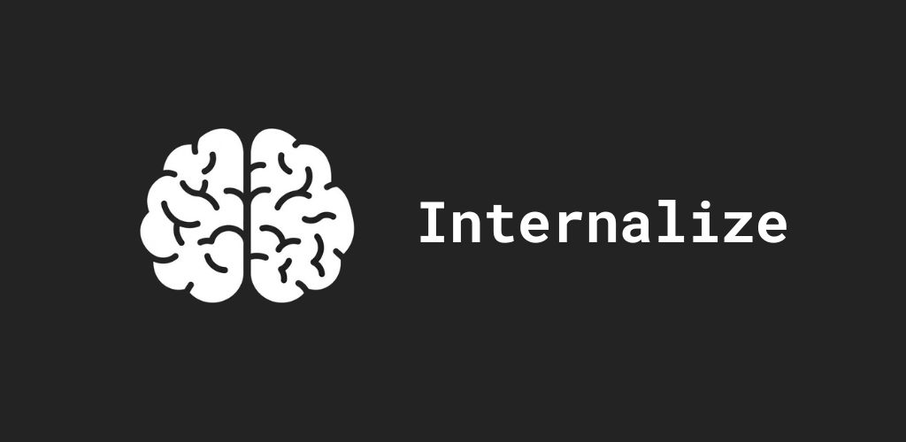
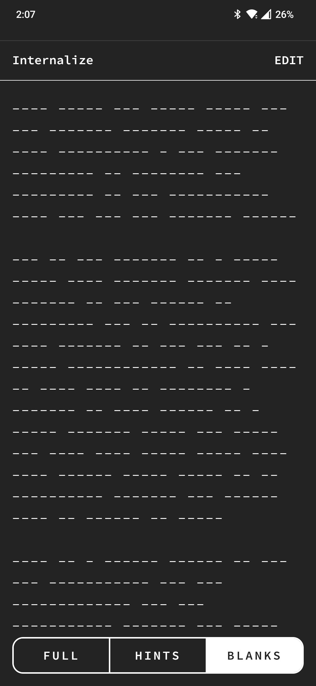
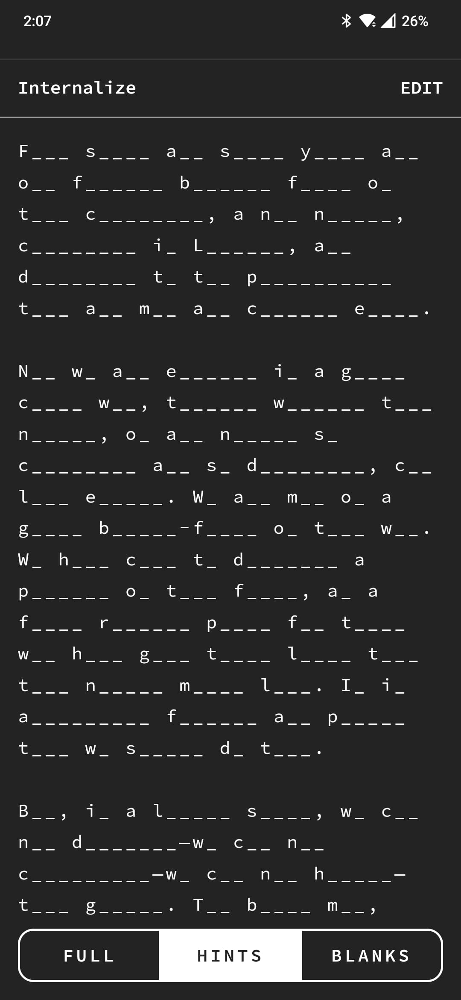
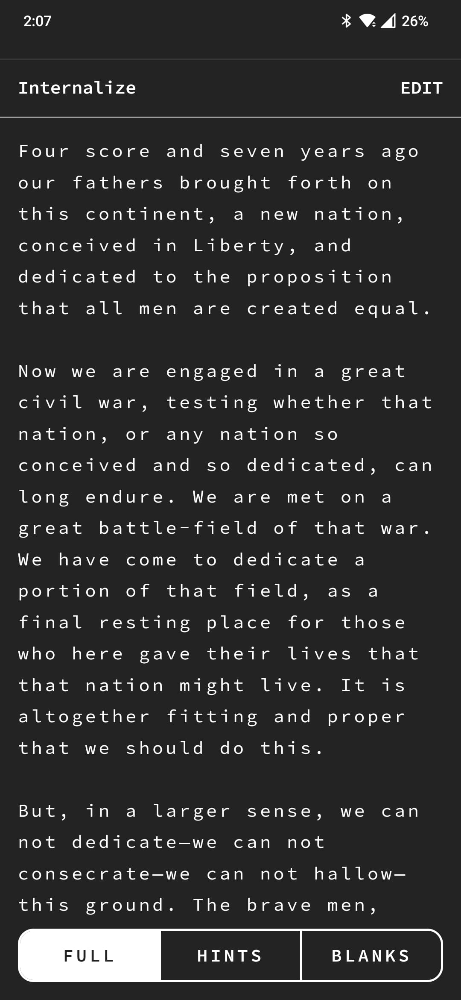

# internalize-web

Web app to help you memorize passages using fill in the blanks!

## Internalize Projects

- [Internalize Flutter](https://github.com/brighamandersen/internalize-flutter)
  - The original MVP project written in Flutter. Got sidelined once I realized I only needed Android support and wanted better performance with Jetpack Compose.
- [Internalize Jetpack Compose](https://github.com/brighamandersen/internalize-web)
  - Also known as just "Internalize", this is the official version of Internalize. It was built after the Flutter app and is faster and leaner (90% smaller APK file).
- [Internalize Web **(This Project)**](https://github.com/brighamandersen/internalize-web)
  - A web app made after Internalize Flutter and Internalize Jetpack Compose. More of a proof of concept for progressive web apps. This project was a simplified version focused on memorizing one passage at a time.

## Screenshots

  
  
  

